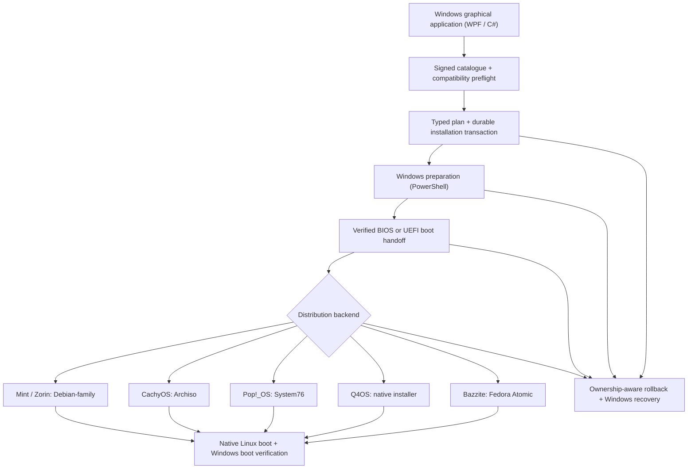

# Gaslux

**Install Linux alongside Windows — without a USB stick or a separate manual Linux installer.**

Gaslux is a Windows-first, graphical dual-boot installation project. Its goal is to let people choose a Linux distribution, allocate space, create an account and complete an installation from Windows 10 or 11, while protecting their existing Windows installation and providing a verifiable recovery path.

Gaslux is built on [Libertix](https://github.com/ekimiateam/libertix). It retains the existing Windows application, transactional installation infrastructure and recovery foundations while evolving towards **independent, distribution-specific installation backends**.

  
  
  
  

  <a href="#project-status">Project status</a> ·
  <a href="#distribution-roadmap">Distributions</a> ·
  <a href="#how-gaslux-is-designed-to-work">How it works</a> ·
  <a href="#safety-first">Safety</a> ·
  <a href="#development-and-testing">Development</a> ·
  <a href="#origin-and-credits">Credits</a>

> [!IMPORTANT]
> **Gaslux is under active development. There is no production-ready Gaslux multi-distribution release.** The `main` branch still contains the original Libertix-based installation path for Linux Mint and Zorin OS. CachyOS, Pop!_OS, Bazzite and Q4OS must **not** be treated as installable or stable in Gaslux. Their presence in the roadmap, experimental branches or development contracts does not constitute release support.

> [!WARNING]
> Installing an operating system modifies partitions and boot configuration. Even when an installer is designed for recovery, there is no guarantee against hardware failure or data loss. **Back up important data and verify that the backup can be restored** before using any disk-writing build.

## The product vision

Gaslux aims to make native Linux dual boot approachable without turning disk management into a guessing game.

- **Start in Windows.** A graphical wizard handles distribution selection, target storage, space allocation, locale and account setup.
- **No installation USB.** Verified installation media are prepared on internal storage; an automated boot handoff starts the correct Linux installer environment.
- **Real, native Linux installations.** Each distribution uses its own supported installation model, package manager and boot management, rather than copying an arbitrary live filesystem.
- **Windows remains a first-class system.** Preserve Windows Boot Manager, recovery facilities, unrelated partitions and existing user data.
- **Independent firmware paths.** Support BIOS/MBR and UEFI/GPT only where the particular distribution and Gaslux backend have been validated.
- **Recoverable operations.** Persist an installation plan, transaction checkpoints and ownership evidence so that failed or cancelled stages can be compensated and independently checked.
- **A beginner-friendly interface.** Show genuine progress, clear compatibility failures and actionable recovery messages, without requiring commands during the intended end-user flow.

**These are design goals for the complete Gaslux product, not a claim that every feature is implemented today.**

## Project status

As of **16 November 2026**, this repository is a development project rather than a separately certified Gaslux installer:

| Area | Current position |
| --- | --- |
| Windows application | Existing Libertix WPF/C# application and installation wizard in `main` |
| Existing installation engine | Linux Mint 22.3 Cinnamon and Zorin OS 18.1 Core, via the inherited Debian/Ubuntu-family path |
| Firmware infrastructure | Inherited BIOS/MBR and UEFI/GPT paths, subject to existing compatibility checks |
| Release metadata | `release-config.json` still identifies **Libertix 0.4** and includes only Mint and Zorin |
| Additional distributions | Experimental research, safeguards and/or draft PRs; **not enabled in the stable catalogue** |
| Complete Windows/Linux dual-boot evidence for new backends | **Not yet established** |
| Gaslux releases | No separate release published in [this repository's Releases page](https://github.com/LMhdez/gaslux/releases) at the time of this update |

The existing Mint/Zorin implementation provides a starting point, **not** a blanket certification of every firmware, disk, encryption and recovery combination. The newer work must not regress its supported paths.

Development work is tracked in the [pull requests](https://github.com/LMhdez/gaslux/pulls), including the [multi-distribution design draft (#7)](https://github.com/LMhdez/gaslux/pull/7), the [signed capabilities draft (#12)](https://github.com/LMhdez/gaslux/pull/12) and the [CachyOS stability acceptance criteria (#3)](https://github.com/LMhdez/gaslux/issues/3). These are work-in-progress references, not released features.

## Distribution roadmap

The target distributions are **Linux Mint, Zorin OS, CachyOS, Pop!_OS, Bazzite and Q4OS**. Every backend must validate an exact supported ISO or installation source, perform a native installation, manage its own updates and bootloader, and verify both systems after reboot.

| Distribution | Gaslux implementation status | Firmware / partition policy |
| --- | --- | --- |
| **Linux Mint** | Existing Libertix backend in `main`; regression and new-product release validation required | Existing BIOS/MBR and UEFI/GPT routes, subject to preflight |
| **Zorin OS** | Existing Libertix backend in `main`; regression and new-product release validation required | Existing BIOS/MBR and UEFI/GPT routes, subject to preflight |
| **CachyOS** | **Experimental only.** Archiso detection, guarded staging, authenticated handoff and boot tests are being developed; no complete certified Windows-to-CachyOS installation | BIOS/MBR and UEFI/GPT are engineering targets, **not verified Gaslux support**; Secure Boot must not be assumed supported |
| **Pop!_OS** | **Planned.** Requires a separate System76-aware installation and boot backend | Firmware-specific strategy to validate; typically systemd-boot on UEFI and GRUB on legacy BIOS |
| **Q4OS** | **Planned.** Requires verification of its native ISO and installation process | No firmware/layout combination is certified for Gaslux yet |
| **Bazzite** | **Planned.** Requires a Fedora Atomic-specific installation, deployment, update and recovery backend | **UEFI/GPT only. BIOS/MBR must be rejected before any disk change** |

A distribution's ability to install on a machine **outside Gaslux** is not evidence that Gaslux can safely install it. Unsupported combinations must remain unavailable in the release catalogue and installer.

### Why separate backends?

These systems do not share a universal installation mechanism:

- **Mint / Zorin:** preserve the current Debian/Ubuntu-family extraction and configuration path.
- **CachyOS:** use a verified, authenticated handoff into a real Archiso environment, followed by appropriate Arch package bootstrap and native boot/update handling. Copying the live squashfs is not a valid installed-system shortcut.
- **Pop!_OS:** integrate the actual System76 installation model and the correct bootloader for the firmware mode.
- **Q4OS:** validate native, partitioned installation media; its Windows-hosted installation option is not equivalent to native dual boot.
- **Bazzite:** respect Fedora Atomic's installer, deployment, bootloader and update model rather than treating it like a traditional mutable distribution.

## How Gaslux is designed to work

The intended user experience has no requirement for a USB stick, a terminal or a second interactive Linux installer.

1. **Choose.** Open Gaslux in Windows and select a released distribution, storage allocation, language, keyboard, time zone, account and any optional file-sharing features.
2. **Check.** Run a non-destructive compatibility preflight against the actual disk, firmware, Windows recovery configuration, encryption state, partition layout, available space and selected distribution's signed capability record.
3. **Prepare.** Download or reuse only authenticated, version-pinned installation artifacts; validate SHA-256 and identity; arm recovery and commit the installation plan before any storage mutation.
4. **Reboot and install.** Start the verified live environment automatically. Revalidate hardware and transaction ownership, invoke the distribution-specific backend, configure Linux and set up the appropriate native boot chain.
5. **Verify.** Boot Linux and Windows, check first-boot evidence, preserve Windows recovery and confirm that the dual-boot arrangement survives supported updates.
6. **Recover or uninstall.** On failure, or when the user requests Linux removal, compensate only verified Gaslux-owned changes and confirm the restored Windows state.

**Today, this complete flow is not implemented for the four additional distributions.** The existing Mint/Zorin path retains its original Libertix behavior while the broader architecture is developed and tested.

### Architecture

The shared safety and transaction infrastructure remains common; each distribution is responsible for its own native installation details.

The diagram describes the **target architecture**; it does not imply that all depicted backends are connected to the Windows application.

## Safety first

Gaslux's primary priority is **Windows and user data integrity**, not the number of distributions shown in a menu.

Before touching a partition, boot record or firmware variable, the installer must establish:

- **Physical identity and exact geometry:** the intended disk, sector size, partition style, partition IDs, offsets, file systems, free space and NTFS shrink feasibility.
- **Windows recovery readiness:** Windows Boot Manager, BCD, WinRE, OEM/Recovery partitions and the required restoration material.
- **Encryption boundaries:** BitLocker and Device Encryption status; no silent decryption bypass or changes to Secure Boot trust keys.
- **Firmware constraints:** real BIOS/MBR or UEFI/GPT state, available MBR primary/extended/logical capacity, or UEFI ESP/NVRAM/BootNext/BootOrder behavior.
- **Artifact trust:** the signed catalogue, pinned hashes and verified distribution-specific ISO identity.
- **Transaction ownership:** durable checkpoints and evidence tying each change to a particular installation, with independent validation after reboot.

Gaslux must **fail closed** if a disk identity is ambiguous, a layout is untested, recovery is unavailable, encryption is unresolved, an ISO is unexpected or a required validation fails. It must never rewrite another installation's partitions or boot files, silently convert MBR to GPT, or change the machine's firmware mode.

A successful-looking log, GRUB menu or simulated test is **not** proof of a working dual boot. Rollback is only verified after checking the actual Windows boot state, partition geometry and relevant BCD/WinRE/ESP or MBR information.

For the detailed inherited transaction contract, see [Architecture](docs/ARCHITECTURE.md) and [UEFI boot-order recovery](docs/UEFI_BOOTNEXT_BOOTORDER.md).

## Compatibility and releases

The eventual Gaslux release catalogue will explicitly bind each eligible distribution to a versioned, signed capability contract: backend, image identity, firmware/partition support, Secure Boot policy, bootloader, package/update model, requirements and release status. An experimental backend must never be selected by the production installer merely because it appears in documentation or metadata.

A configuration is not ready for a stable release until disposable, snapshot-backed test systems have demonstrated:

- Actual Linux and Windows boots after installation.
- Windows 10 BIOS/MBR, Windows 10 UEFI/GPT and Windows 11 UEFI/GPT **where applicable**.
- Correct behavior for single-disk and second-disk layouts, including complex MBR cases when supported.
- Secure Boot and encryption acceptance/rejection **before mutation**.
- Kernel/bootloader updates followed by successful reboots into both operating systems.
- Interrupted downloads, invalid hashes, lost network, storage errors, boot failures and power-loss recovery.
- Linux removal and verified restoration of Windows partition geometry, BCD, WinRE and boot-chain state.
- Human review of reproducible evidence; physical-disk testing only with explicit authorization and verified backups.

**Bazzite's BIOS/MBR test is a mandatory preflight rejection test, not an installation test.**

Existing CI, unit tests, signed contracts, mocked ISOs and isolated QEMU/OVMF boot smoke tests provide valuable coverage, but do not replace a complete Windows/Linux/recovery test. See [issue #3](https://github.com/LMhdez/gaslux/issues/3) for the CachyOS release gate.

### Downloading Gaslux

**There is no released Gaslux installer to recommend for real machines yet.** Follow [Releases](https://github.com/LMhdez/gaslux/releases) for future published builds. Do not run an experimental branch or an unsigned build against a computer containing important data.

The upstream Libertix application and its releases are separate from Gaslux; see [the original Libertix project](https://github.com/ekimiateam/libertix). This repository currently still contains upstream-named executables, build artifacts and release settings while the product transition is in progress.

## Development and testing

The repository keeps its inherited implementation languages and boundaries instead of rewriting functioning infrastructure solely to change branding.

| Component | Repository paths / tools |
| --- | --- |
| Windows UI and orchestration | WPF, C#, .NET Framework 4.8; `Pages/`, `Installation/`, `Models/` |
| Windows disk preparation and recovery | PowerShell; `Scripts/modules/`, `Scripts/uefi/` |
| Live and target runtimes | Bash / Python; `assets/live/`, `iso/`, `iso-uefi/` |
| Installation and release contracts | JSON Schema, pinned and signed metadata; `schemas/`, `release-config.json`, `iso-tools/` |
| Build and automation | GitHub Actions, Docker-based ISO builder, `auto_tests/` |
| Existing test suites | `Libertix.Tests/`, `PowerShell.Tests/`, `auto_tests/` |

Start with [CONTRIBUTING.md](CONTRIBUTING.md), [AI_POLICY.md](AI_POLICY.md), [Architecture](docs/ARCHITECTURE.md), [Releases and signing](docs/RELEASES.md) and the [VM/test service guide](auto_tests/README.md).

The existing Windows build is based on `Libertix.sln`, and the two inherited installer images are built with `./iso-tools/build-isos-docker.sh all`. The names will remain in some implementation files until a separately reviewed migration is safe. **Do not infer a completed rebrand or new release from this README change.**

Contributions should use a dedicated branch and a reviewed pull request, preserve Mint/Zorin regressions, run the relevant C#/Pester/Python/ShellCheck/build checks, and distinguish read-only unit tests from real VM boots or recovery evidence. Never run destructive tests on an ordinary physical disk.

### Validate the existing baseline

The current repository still uses the inherited Libertix build and test entry points. Run relevant checks in a configured development environment before submitting installation or recovery changes.

**Windows application** (Visual Studio 2022 Build Tools and the .NET Framework 4.8 targeting pack):

~~~powershell
msbuild .\Libertix.sln /restore /m /p:Configuration=Release "/p:Platform=Any CPU"
~~~

**Python regression suite** (requires `uv` and the dependencies declared in `auto_tests/`):

~~~bash
cd auto_tests
uv sync --frozen --extra dev
uv run --frozen python -m ruff check app tests tools ../assets/live/*.py ../iso-tools/*.py ../grub/*.py
uv run --frozen python -m ruff format --check app tests tools ../assets/live/*.py ../iso-tools/*.py ../grub/*.py
uv run --frozen python -m pytest --cov=app --cov-report=term-missing --cov-fail-under=70
~~~

The relevant CI jobs also run C# contract tests, PowerShell/Pester validation, ShellCheck and ISO builds. For VM automation, configuration, and safety restrictions, follow [auto_tests/README.md](auto_tests/README.md). **Passing these tests alone does not certify a new backend for a real Windows dual-boot installation.**

## Origin and credits

**Gaslux is based on [Libertix](https://github.com/ekimiateam/libertix)** and builds upon its original architecture, code, design and documentation. This new project identity does not erase the original authorship or imply that the original maintainers endorse or maintain Gaslux.

**Original Libertix development:** Félix ([felix068](https://github.com/felix068)) and **Ekimia**.

**Original contributors:** Michel Memeteau, **MopigamesYT / Margot**, and **Aamir Shahzad**, along with everyone who contributed code, testing, reports and documentation.

**Original Libertix supporters:** **Olivier**, **Boyka**, **Coin des Geeks** and **Matthieu**, as well as anonymous donors. The original Libertix campaign exceeded its €3,000 goal with 41 donations. Those donations supported **Libertix**, not a Gaslux fundraising campaign. The [original Libertix donation page](https://ekimia.fr/donations/campagne-libertix/) is preserved here for attribution and anyone wishing to support that original project.

Additional acknowledgements:

- [Rosé Pine](https://rosepinetheme.com/) — original application color palette.
- [WPF](https://github.com/dotnet/wpf) — Windows desktop UI framework.
- Other bundled dependencies, binaries and fonts — see [THIRD_PARTY.md](THIRD_PARTY.md) and their respective notices.

## License

Gaslux inherits and preserves the **GNU General Public License v3.0** terms of the original codebase. See [LICENSE](LICENSE) and [THIRD_PARTY.md](THIRD_PARTY.md). Source provenance and third-party attributions must be retained through future rebranding and distribution changes.
