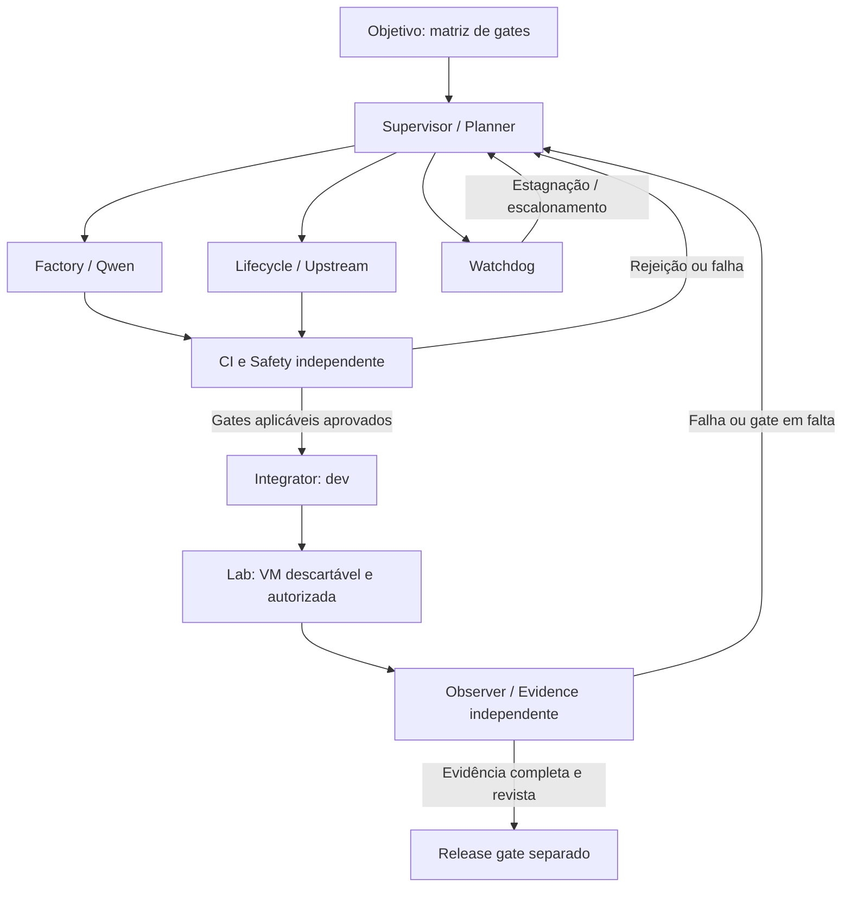

# GASLUX — Avaliação da arquitetura e transição para autonomia

**Snapshot histórico: 2026-11-24, 20:35 UTC.** Avaliação técnica e roadmap proposto, não autorização de execução, certificação ou alteração de política. Generated-by: ChatGPT (GPT-6.2), por solicitação do responsável do projeto. Revalidar os HEADs, PRs e runs antes de usar este relatório para decidir uma missão.

## 1. Objetivo original e diagnóstico

O projeto começou com vários chats especializados no ChatGPT (Supervisor, Safety, Integrator, Observer e responsáveis pelas distribuições), coordenados manualmente pelo utilizador. O objetivo da automação é substituir esta distribuição manual de missões por um ciclo de engenharia externo ao ChatGPT, capaz de selecionar trabalho, implementar, testar, rever, integrar, experimentar, corrigir e manter o instalador USB-free Windows/Linux.

**Conclusão:** a automação é real, mas a substituição dos chats ainda é parcial. A arquitetura é adequada para desenvolvimento autónomo limitado; não demonstra ainda autonomia integral nem produto pronto para produção. Uma Factory que produz código e PRs não equivale a uma Factory que entrega funcionalidades comprovadas.

Preservar backends nativos independentes (Mint, Zorin, CachyOS, Pop!_OS, Q4OS, Bazzite) e partilhar a infraestrutura de segurança, transações, planos, recuperação e evidência. Não reescrever a base Libertix só para uniformizar as distribuições. A autoridade de execução permanece em [AI_POLICY.md](../AI_POLICY.md), [AGENTS.md](../AGENTS.md), [ARCHITECTURE.md](ARCHITECTURE.md) e contratos aplicáveis.

| Componente | Avaliação qualitativa |
| --- | --- |
| Arquitetura multiagente | Boa |
| Separação de responsabilidades | Muito boa |
| Segurança por desenho | Muito boa; eficácia integral por demonstrar |
| Desenvolvimento autónomo | Em evolução |
| Feature Factory/Qwen | Operacional, escopo limitado |
| Integração automática | Parcial |
| Ciclo de vida | Bem encaminhado |
| Laboratório real | Insuficiente para aceitação integral |
| Validação do instalador | Incompleta |
| Produção | Prematura |

## 2. Evidência operacional confirmada

Os seguintes dados foram consultados no GitHub durante a avaliação de 24 de novembro (não são novos testes executados pelo autor deste relatório).

| Fonte | Observação UTC | Resultado e limites |
| --- | --- | --- |
| [PR #411](https://github.com/LMhdez/gaslux/pull/411) | 17:51:43 | Criada por gaslux-autonomous-publisher[bot], CachyOS, Draft aberta no momento da consulta. Proposta Qwen3.5 9B de helper read-only. |
| [PR #415](https://github.com/LMhdez/gaslux/pull/415) | 18:25:17 | Mesmo bot, Bazzite; Draft criada e posteriormente fechada. Não constitui merge nem release. |
| [Factory run 45477215988](https://github.com/LMhdez/gaslux/actions/runs/45477215988) | 20:06 | select e triage_missing_gates concluídos com sucesso; contracts, model, safety e publish_draft skipped. |
| [Factory run 45471955321](https://github.com/LMhdez/gaslux/actions/runs/45471955321) | anterior | select success, triage_missing_gates failure; restante geração skipped. Não confundir falha anterior com estado mais recente. |
| [PR #414](https://github.com/LMhdez/gaslux/pull/414) | confirmada nos logs das 20:06 | Integrada em main (merge d408ffa); Ruff antes da publicação e deduplicação de propostas por role, incluindo bases dev diferentes. |
| [PR #416](https://github.com/LMhdez/gaslux/pull/416) | snapshot da avaliação | Proposta de readiness Windows VM e fila Safety no Lifecycle existente; não assumir integração ou execução. |
| [PR #417](https://github.com/LMhdez/gaslux/pull/417) | 20:29:13 | Draft aberta, proposta de admissão read-only de PRs distro por CI e revisão Safety no HEAD exato. Não concede auto-merge, não prova identidade configurada ou testes VM. |

Base dev observada nos logs da Factory: `d89f1547c50787e4640164e34bfd1863134e2908`. Main observada nesses logs: merge `d408ffa` de #414. Não são afirmações sobre os HEADs futuros.

O job de triagem do run 45477215988 registou `status=waiting_for_review`: Mint `already_queued`; Zorin, CachyOS, Pop!_OS, Q4OS e Bazzite `pending_existing_pr`. O seletor mostrou zero slots declarados não verificados e zero slots independentemente verificados. Não houve nova inferência neste run; sucesso do workflow não é sucesso de geração. O bot demonstrou publicação independente de mensagens no ChatGPT, mas a identidade da publicação por si só não prova origem de todos os commits ou autonomia geral.

## 3. Agentes: o que funciona e o que falta

| Papel | Estado à data | Limites |
| --- | --- | --- |
| CLOCK / Raspberry Pi | Agendamento automatizado, conforme histórico operacional e documentação | Não é um LLM; disponibilidade do Pi e do cron GitHub deve ser monitorizada. |
| Feature Factory / Qwen 3.5 9B | Automatização operacional demonstrada por PRs do bot e runs | Escopo AST restrito, helpers read-only e tarefas aprovadas; não é desenvolvimento arbitrário do instalador. |
| Supervisor | Supervisão programada implementada | Seleção e avaliação delimitadas; autonomia geral de planeamento não demonstrada. |
| Lifecycle | Pesquisa/testes programados implementados | Contratos e live boot não são instalação completa. |
| Integrator | Parcial | Allowlist automática histórica de dois mapeamentos de teclado; não admite genericamente as PRs das seis distros. #417 propõe admissão read-only. |
| Safety | Parcial | Gates automáticos AST/funcionais/CI não equivalem a revisão independente de todas as alterações. |
| Safety-2 | Independência autónoma não confirmada | Exige autoridade, identidade, evidências e execução independentes. |
| Observer | Autonomia integral não confirmada | Observação HOST/QEMU não comprova automaticamente origem Guest ou rollback. |
| Mint | Desenvolvimento autónomo parcial | Tarefa em fila; instalação integral Windows/Mint pendente de provas. |
| Zorin | Desenvolvimento autónomo parcial | PR existente em revisão. |
| CachyOS | Desenvolvimento autónomo parcial | PR existente em revisão; native install por provar. |
| Pop!_OS | Desenvolvimento autónomo parcial | PR existente em revisão. |
| Q4OS | Desenvolvimento autónomo parcial | PR existente em revisão. |
| Bazzite | Desenvolvimento autónomo parcial | PR existente em revisão; rejeitar BIOS/MBR. |

Os seis papéis são especializações, em parte, da mesma Factory; não são necessariamente seis LLMs independentes a trabalhar continuamente. Os chats não se transformam automaticamente em processos persistentes. CLOCK, Supervisor e Lifecycle podem ser automações determinísticas em vez de agentes LLM.

Se o utilizador fechar o ChatGPT, os workflows configurados continuam enquanto o agendamento, recursos, credenciais e repositório estiverem operacionais. Não há garantia de 24/7, de execução de cada cron ou de progresso se não houver tarefa elegível. Nesta observação, a fila Safety era o bloqueio à geração adicional; não é motivo para contornar gates.

Faltam: planeamento automático de missões complexas, revisão Safety operacionalmente independente, reparação automática após rejeição, integração de escopo mais amplo devidamente aprovada, laboratório real e feedback para a Factory. Manter os chats como apoio transitório até demonstrar ciclos completos sem intervenção manual de coordenação.

## 4. Matriz de objetivos e risco de falsa evolução

Fontes em dev: [goal.json](https://github.com/LMhdez/gaslux/blob/d89f1547c50787e4640164e34bfd1863134e2908/docs/autonomy/goal.json) e [evidence.json](https://github.com/LMhdez/gaslux/blob/d89f1547c50787e4640164e34bfd1863134e2908/docs/autonomy/evidence.json). Na consulta, a matriz tinha 17 combinações backend/plataforma (cinco backends × três, Bazzite × dois) e oito gates por combinação: **136 slots**, dos quais **34 automáticos seguros** e **102 protegidos**. Bazzite BIOS/MBR é caso de rejeição obrigatória, fora dos 136 slots suportados. O catálogo tinha **zero registos formais**, não zero testes realizados.

Os dois gates automáticos seguros são source-authenticity e windows-preflight; os seis protegidos são install, linux-first-boot, windows-return, linux-update-reboot, uninstall-windows-integrity e fault-injection-rollback. Nem um gate declarado por código nem um relatório de CI constitui, isoladamente, evidência independente. Os 136 slots não são uma estimativa de percentagem de desenvolvimento.

O risco dominante é acumular helpers válidos e PRs sem aproximar o produto da instalação real. Medir progressos por gates independentemente aceites, resolução de bloqueios e funcionalidades com provas, não por linhas de código, contagem de PRs ou runs verdes.

## 5. Arquitetura-alvo: fechar o ciclo de engenharia

Responsabilidades propostas, não novos workflows ou permissões automaticamente concedidas. Preferir ampliar os componentes existentes, após revisão, evitando duplicação.

| Responsabilidade | Componente existente a aproveitar | Prioridade |
| --- | --- | --- |
| GASLUX-LAB: instalação real, snapshots, updates e recuperação em VM | Lifecycle + laboratório QEMU/OVMF | P0 |
| GASLUX-PLANNER: tarefas acionáveis, dependências, escopo, testes, bloqueios | Supervisor + triagem Factory | P0 |
| GASLUX-EVIDENCE: registo persistente de provas independentes | Observer + Safety + registo goal/evidence | P0 |
| GASLUX-WATCHDOG: heartbeat, ausência de progresso, filas, retries limitados | Supervisor + painel de progresso + CLOCK | P1 |
| GASLUX-REDTEAM: testes adversariais, interrupção e recuperação | Safety/Safety-2 + VM lab | P1 |
| GASLUX-UPSTREAM: mudanças de ISO, instalador, boot e updates | Lifecycle + responsáveis dos backends | P1 |
| GASLUX-RELEASE: elegibilidade, assinatura e publicação controlada | Infraestrutura existente de release + revisão | P2 |

A ordem exata de CI/VM/merge depende do risco: executar a aceitação VM do candidato antes do merge quando exigida; a figura não permite adiar um gate obrigatório para depois da integração. Falha real deve originar uma missão de diagnóstico, correção, revisão e novo teste, com limites de retries e escalonamento quando não houver solução segura.

## 6. Riscos previsíveis e mitigação

São previsões qualitativas, não garantias de ocorrência ou datas.

| Risco | Nível | Mitigação proposta |
| --- | --- | --- |
| PRs acumuladas sem integração | Muito elevado | Fila por dependência, revisão exata, deduplicação, escalonamento. |
| Helpers read-only repetitivos | Muito elevado | Tarefas vinculadas a gaps reais e escopos revistos. |
| Repetir investigação concluída | Elevado | Ledger de missões, resultados persistentes e chave idempotente. |
| Armazenamento/CPU GitHub insuficientes | Elevado | Preflight, quotas reais, snapshots e runner isolado alternativo se necessário. |
| Alterações upstream quebram backends | Elevado | Detetar versões/hash e executar regressão antes de mudar catálogo. |
| Corridas entre agentes | Elevado | Lock/lease por missão, HEAD imutável, revalidação da base e merge condicionado. |
| Falsa segurança por CI verde | Elevado | Níveis de evidência distintos, testes reais, independent review. |
| Dependência de um LLM | Moderado | Routing de modelos por escopo e complexidade, sem entregar credenciais ou reduzir gates. |
| Dependência do Pi | Moderado | Heartbeat, fallback idempotente, alertas e controlo de duplicação. |
| Expiração de evidências | Moderado | Manifesto persistente com hashes, proveniência e política de retenção adequada. |

Manter Qwen 3.5 9B para tarefas simples e delimitadas. Avaliar modelos mais capazes ou engenharia humana para bootloaders, arquitetura e recuperação; custo, disponibilidade, identidade, isolamento e permissões devem ser explicitamente avaliados. Nunca confundir a escolha de modelo com Safety independente.

## 7. Roadmap e critérios de autonomia

| Fase | Estado em 24/11 | Critério verificável proposto |
| --- | --- | --- |
| 1. Desenvolvimento | Parcialmente operacional | Tarefa elegível → inferência real → testes → Draft pelo bot. |
| 2. Integração | Em desenvolvimento | Revisão e CI no HEAD exato → merge permitido em dev → CI pós-merge, sem coordenação manual rotineira. |
| 3. Experimentação | Próxima prioridade | Windows/Mint instalado por Gaslux numa VM descartável, ambos OS arrancam, atualização, desinstalação e recuperação provadas. |
| 4. Autocorreção | Futuro | Uma falha real origina tarefa deduplicada, correção, revisão e reteste com evidência. |
| 5. Manutenção | Futuro | Alteração upstream detetada, validada e tratada com regressões dos backends. |
| 6. Publicação | Objetivo final | Release elegível, reproduzível, assinada e sujeita a autoridade e gates próprios. |

Antes de considerar a substituição dos chats concluída, demonstrar múltiplos ciclos end-to-end com tarefas distintas, incluindo uma rejeição Safety e recuperação de um bloqueio, sem intervenção humana de orquestração rotineira. A supervisão humana substantiva, autorizações reservadas e kill switch permanecem. Não há prazo de conclusão verificável.

## 8. Ações prioritárias propostas

1. Concentrar a infraestrutura partilhada no primeiro ciclo completo Windows + Mint; manter Zorin e restantes backends em paralelo quando as tarefas forem elegíveis.
2. Resolver as PRs da fila existente (#395, #400, #411, #412, #413) mediante os gates aplicáveis; confirmar estado atual antes de atuar. Não regenerar duplicados nem promover Draft automaticamente.
3. Tornar operacional a admissão Safety independente e exact-HEAD; continuar o trabalho de #417 e #401 sem assumir autorização de merge.
4. Implementar registo persistente e independentemente validado de provas, sem inserir registos artificiais em evidence.json.
5. Ligar gaps reais do Supervisor a escopos acionáveis, testes e feedback; tratar tarefas rejeitadas com retries limitados.
6. Confirmar capacidade física, origem legal e autenticada da imagem Windows, quotas e snapshots restauráveis do laboratório. O [plano compacto em dev](https://github.com/LMhdez/gaslux/blob/dev/docs/COMPACT_VM_INSTALL_LAB.md) prevê disco virtual 60 GiB, orçamento físico de planeamento 80 GiB; não é prova de capacidade efetiva ou autorização de writer. Não publicar imagens Windows ou credenciais.
7. Instrumentar ausência de progresso, tempos em fila, custos, gates aceites, taxa de falhas, idade da última prova e alertas. Se o runner GitHub não cumprir os limites, avaliar runner alternativo isolado.
8. Revalidar contratos nativos por distribuição e preservar regressões Mint/Zorin. Release e testes físicos continuam sujeitos às autorizações próprias.

## 9. Limites e referências

Este relatório é uma avaliação datada, não um novo contrato de segurança, nem prova de execução de todos os agentes. Foram consultadas PRs do bot, logs/jobs da Factory e documentação, incluindo o workflow Lifecycle e a matriz dev; não foram auditadas individualmente todas as execuções recentes de cada agente, nem executados novos testes de instalação. Não assumir disponibilidade de Windows legal, capacidade de runner, revisão independente ou aceitação de release sem evidência específica.

- [Automação rápida](GASLUX_FAST_AGENT_DEVELOPMENT.md)
- [Painel e pausa](GASLUX_AGENT_PROGRESS.md)
- [Integrator](GASLUX_ACTIONS_AGENT_INTEGRATOR.md)
- [CLOCK](GASLUX_ACTIONS_AGENT_CLOCK.md)
- [Lifecycle](GASLUX_LIFECYCLE_RESEARCH_CLOCK.md)
- [Plano multi-distro](https://github.com/LMhdez/gaslux/blob/dev/docs/MULTIDISTRO_PLAN.md)
- [Issue #401 — handoff de gaps para tarefas](https://github.com/LMhdez/gaslux/issues/401)

**Direção recomendada:** passar de uma fábrica de código para uma fábrica de funcionalidades comprovadas, sem reduzir a segurança. Manter a documentação atualizada por eventos conforme AGENTS.md; preservar este snapshot histórico e acrescentar observações datadas posteriores, em vez de reescrever resultados.

## 9. Auditoria histórica alargada — atualização 24/11/2026, 20:40 UTC

**Complemento ao snapshot das 20:35.** Inventário REST paginado: 413 PRs visíveis entre #1 e #419; 71 merged (incluindo branches experimentais), 88 open, 254 closed sem merge. Não significa auditoria individual das 413. `main=d408ffa603272007d9cb0c2c896ed1789f775a80`, `dev=d89f1547c50787e4640164e34bfd1863134e2908`. O índice estruturado [GASLUX_HISTORICAL_EVIDENCE_INDEX.json](GASLUX_HISTORICAL_EVIDENCE_INDEX.json) é **discovery-only**, separado do registo formal de gates em dev. Nenhuma entrada concede merge, writer ou release. A evidência antiga não equivale a validação do HEAD atual.

### Provas e dependências que devem ser reutilizadas

| Fonte histórica | Resultado verificado nos jobs / limite |
| --- | --- |
| [#113 / run 44085976726](https://github.com/LMhdez/gaslux/actions/runs/44085976726) | Windows 10 Enterprise Evaluation instalado em KVM, ISO SHA256 e boot disco-only, shutdown limpo. JSON: windowsClientBootVerified=true, dualBootVerified=false, winReAndBcdRecovered=false. |
| [#117 / run 44094951108](https://github.com/LMhdez/gaslux/actions/runs/44094951108) | Windows 11 Enterprise Evaluation instalado em KVM, ISO SHA256, disco-only e shutdown limpo. Não comprova recuperação após Linux. |
| [#119 / run 44095873813](https://github.com/LMhdez/gaslux/actions/runs/44095873813), [#125](https://github.com/LMhdez/gaslux/pull/125) | Validadores de artefactos históricos com SHA e ZIP delimitado. Consistência documental não autentica origem guest. Os três runs antigos já não devolvem artefactos no endpoint list; não assumir que os ZIP estão recuperáveis. |
| [#260 / run 44704787925](https://github.com/LMhdez/gaslux/actions/runs/44704787925) | Windows→Mint→Windows na mesma COW; logs confirmam Mint firstboot e quarto Windows ESP/BCD/WinRE; nativeGrubDualBootVerified=false, updatesVerified=false, rollbackVerified=false. SHA do run 98d7b450... é histórico, distinto do HEAD final da PR. |
| [#269 / run 44713947097](https://github.com/LMhdez/gaslux/actions/runs/44713947097) | Windows10/Pop real read-only; Safety DENY_NO_WRITER por transação ausente/inválida e proveniência não autenticada. |
| [#383 / run 45064724367](https://github.com/LMhdez/gaslux/actions/runs/45064724367) | QCOW2+OVMF restore fixture, não guest. Safety [F-383-01/02](https://github.com/LMhdez/gaslux/pull/383#issuecomment-7085401815) continuam abertos; corrigir confinamento report e TOCTOU OVMF na mesma branch. |
| [#388 / run 45067845469](https://github.com/LMhdez/gaslux/actions/runs/45067845469) | Reserva física 64,424,517,632 bytes; host 91,255,799,808 bytes antes, 26,831,273,984 depois; 384 MiB ENOSPC e restauro, 60 GiB quota fixture, não exaustão integral. 2/11 checkpoints. ISO portuguesa ausente nesta execução específica. |

**Media:** os logs históricos fixaram Windows 10 Evaluation 5,550,497,792 bytes, Windows 11 Evaluation 8,225,329,152 bytes. Mint 22.3: 3,091,660,800 bytes. Reaproveitar os perfis Microsoft e scripts de `#232@3f44ae2068fabe875f160ca007393f9e3eb99367` (windows_x64_official_evaluation_isos.json, windows_x64_full_iso_sha256.py, windows_x64_tcg_firstboot.py), validar atualmente a origem/licença e orçamento por fase. Não assumir que a #418 ou um armazenamento privado novo são pré-requisitos absolutos. Não publicar ISO, QCOW2, TPM, keys, credenciais ou media licenciado.

**Retenção urgente:** metadados GitHub indicam artefactos #14617010437 (Mint) e #14618774049 (Safety) ainda listados, expiração 27/11/2026 UTC. #14770149177 e #14771887332 expiram 06/12. Os digests e datas constam do índice. Não foram descarregados nem verificados byte a byte nesta auditoria. Preservar somente provas textuais/JSON permitidas, seguindo validadores #119/#125, antes de expiração; não declarar preservação realizada sem confirmar.

### Janela de investigação obrigatória conforme AGENTS.md e AI_POLICY.md em dev

Antes de selecionar ou implementar missão: pesquisar histórico de PRs abertas/fechadas/merged (incluindo bases experimentais), commits e árvores fixadas, workflows históricos e jobs concretos, findings Safety, dependências e artefactos. Usar o manual [AGENT_HISTORICAL_PLAYBOOK.md em dev](https://github.com/LMhdez/gaslux/blob/d89f1547c50787e4640164e34bfd1863134e2908/docs/AGENT_HISTORICAL_PLAYBOOK.md) e [CI_VM_EVIDENCE_INDEX.md em dev](https://github.com/LMhdez/gaslux/blob/d89f1547c50787e4640164e34bfd1863134e2908/docs/CI_VM_EVIDENCE_INDEX.md). Classificar o que existe em dev, o que está numa branch histórica e o que foi observado num run antigo. Preferir recuperar código e evidência, não criar controlador ou workflow duplicado. Revalidar antes de cada decisão; atualizar os documentos afetados na mesma missão. Não relançar VM apenas para atualizar data.

### Ordem de trabalho e autoridade

- P0 preservar provas históricas e reconciliar com Supervisor/Factory (#408 já tem inventário de 136 slots, 34 scope review e 102 protegidos); registo formal continua zero. Não importar automaticamente provas parciais.
- P0 resolver #383 findings, reconciliar #388 e testar composição exata, integrar apenas após gates aplicáveis. Recuperar Windows histórico e ligação Mint, não recomeçar de uma ISO genérica.
- P0 rever #416/#417/#418 contra histórico: #417 não deve exigir formal GitHub APPROVE para toda a integração manual delegada quando AGENTS.md admite avaliação técnica independente; autoridade automática exige proveniência autenticada. Não aceitar comentários como credencial. Verificar histórico multi-commit dos branches Ruff e deriva de dev; preservar mudanças únicas. #418 CI #45481512209 SUCCESS; privada opcional. Evitar sobreposição #416/#418.
- Reutilizar #300/#302 (autoridade protegida/ledger offline deny-only), #307 (FD GPT), #337/#346/#356 (QEMU/GPT read-only), #393/#407 (Mint já merged) e #414 (dedup/Ruff). Não confundir contratos offline com trust root operacional.

Referências de decisões e auditoria: [issue #401, reconciliação histórica](https://github.com/LMhdez/gaslux/issues/401#issuecomment-7143774099), [inventário completo](https://github.com/LMhdez/gaslux/issues/401#issuecomment-7143839879). Nenhum gate formal, código runtime, workflow, scheduler, permissão ou política é alterado por este índice documental.

## 10. Memória operacional — implementação proposta

A mesma PR acrescenta inventário completo de PRs com candidatos de dependência por base-ref (não prova de ancestralidade), um SKILL.md portável, parser delimitado de histórico e testes adversariais. O workflow Factory existente publica referências por distribuição no job select; a triagem acrescenta leads a novas issues de revisão. Não existe carregamento nativo de skills pelo Qwen, nem alteração dos prompts/modelo, AST, publisher ou permissões. A consulta histórica não concede autoridade. A execução operacional depende de revisão e integração desta PR.

## 11. Skills e dependências verificadas — 24/11/2026

Oito skills portáveis em [agent-skills](agent-skills/README.md); seleção por role/gate no CLI existente, contexto delimitado (até 12 comparações, divergências primeiro), referências nas issues de triagem. Comparações GitHub exatas em [GASLUX_HISTORICAL_DEPENDENCY_AUDIT.json](GASLUX_HISTORICAL_DEPENDENCY_AUDIT.json): 25/286 candidatas auditadas; 19 ancestry positiva e 6 divergências. As restantes não estão confirmadas. Atribuição automática de skills não equivale a execução de revisão, prova de VM ou aprovação. Não alterámos Qwen prompt, AST, modelo, scheduler, permissões ou formal evidence register. Revisão independente e integração ainda necessárias.

## 12. OpenCode nativo — ensaio isolado (24/11/2026)

Na mesma Factory, job opencode_trial independente do pipeline de publicação: PR #419 same-repo e, após integração, workflow_dispatch main com input opencode_trial=true. O dispatch de ensaio exclui select/model/publisher. A Factory original permanece o fallback operacional, sem seleção automática de OpenCode. O ensaio usa OpenCode v1.19.6 (asset oficial linux-x64-baseline.tar.gz SHA256 8443113b3f3dfebf8b0fa91c4377e5519a62b9231732d9344a5df001e4a852b3, GitHub release metadata), Ollama/modelo/digest já fixados. Copia as oito skills para diretórios .opencode/skills/gaslux-<name>/SKILL.md com nomes conformes. Ambiente scratch sem checkout de produto, sem token de escrita, sem shell/edit/web/MCP; só ferramenta skill permitida. Não equivale a sandbox OS; dependências do provider podem ser resolvidas em runtime. Não usa --auto. Verifica evento tool_use completed e conteúdo nativo da skill, mesmo validador AST e fixtures da Factory, tempo e digest. Só relatório JSON separado, nunca consumido por Safety/publisher. Contextos configurados diferentes (direto 5800; OpenCode 65536 conforme docs), comparação exploratória não benchmark controlado. Não prova qualidade geral, regressões de produto ou autorização de código; antes de qualquer promoção, revisão independente, isolamento reforçado, comparações repetidas e aceitação do produto. Referências: https://opencode.ai/v1/docs/skills/ ; https://opencode.ai/v1/docs/permissions/ ; https://docs.ollama.com/integrations/opencode ; https://github.com/anomalyco/opencode/releases/tag/v1.19.6 .

### Continuação da auditoria de dependências — 24/11/2026

Foram acrescentadas 44 comparações GitHub Compare de SHA exatos, em três lotes, à snapshot fixa de 414 PRs e 286 relações candidatas. Total: 69/286 comparações conclusivas (58 ancestrais estritos, 10 divergências e 1 relação inversa); 217 por verificar. Novas divergências #11→#15, #17→#24, #20→#32 e #50→#53. #20→#29 está atrás do SHA candidato a pai; não é uma descendência. Os pares inversos são conservados em other_comparisons, fora do parser existente de ascendência estrita/divergência. O índice JSON contém todos os SHA, merge base, ahead/behind, estado e lotes. Não é prova de equivalência funcional, aprovação, ou autorização. A PR #419 recebeu uma alteração concorrente para a experiência OpenCode, preservada; não alterámos workflows, skills, permissões ou gates nesta auditoria. Qualquer novo HEAD requer revalidação aplicável. O limite de chamadas exige trabalho em lotes; não reivindicamos auditoria integral.

### OpenCode RED → diagnóstico v2 (24/11/2026)

Runs [45485930563](https://github.com/LMhdez/gaslux/actions/runs/45485930563) e [45486258758](https://github.com/LMhdez/gaslux/actions/runs/45486258758): instalação e digest PASS; Qwen direto aceite em 44.54s e 46.48s (mesmo SHA de candidato ce97b21fdd1767834b1531a46f5bf557f842ddbf3adfc491b3a143c90ab33c27); OpenCode não aceite em 35.66s e 31.96s, ValueError genérico, sem testemunho de skill. Não está identificada a causa raiz. Artefacto RED #14964691431, ZIP SHA f46374cea8543b1760fe152ad99168705d8ecd249522e99fcaf0b0c6ee1511e3. O código upstream v1.19.6 skill/index.ts confirma cfg.skills.paths e tool/skill.ts confirma skill_content. v2 explicita o caminho local das skills e OPENCODE_CONFIG, desativa descoberta externa, classifica eventos/erros/estágio AST com categorias fixas, retém testemunho de skill mesmo se o JSON final falhar. Não retém texto arbitrário do modelo/stderr; não altera allowlist de ferramentas nem permissões. Mantém limite de ficheiro do processo (eventual causa a diagnosticar), validação AST e isolamento experimental. A correção da descoberta é hipótese, não resolução confirmada. Novo ensaio precisa de resultado real e revisão independente.

### OpenCode RED v2 → correção de recursos v3 (24/11/2026)

Run [45487427219](https://github.com/LMhdez/gaslux/actions/runs/45487427219), job 138776425610, HEAD 6da06fc2c254c543e287e3e992e1ec5b8b9435c2: Qwen direto aceite 44.84s, OpenCode falhou 28.75s, CLI_NONZERO/FILE_SIZE_LIMIT; sem eventos de skill. O limite RLIMIT_FSIZE de 2 MiB abrangia todos os ficheiros internos, não só stdout/stderr. v3 separa limite interno por ficheiro de 512 MiB e captura incremental de stdout/stderr de 2 MiB cada, sem guardar saídas brutas; monitor periódico do scratch (2 GiB e 100000 entradas, reserva de 4 GiB), timeout e término do grupo de processos. Monitor não equivale a quota física nem sandbox; processo pode ultrapassar limite entre amostras. Não relaxa permissões do agente, validação AST ou autoridade. Testes negativos de streams, timeout e capacidade, e teste positivo de ficheiro interno >2 MiB. A execução real deverá confirmar se remove o bloqueio; não afirma compatibilidade ou aceitação de skill antes disso.
