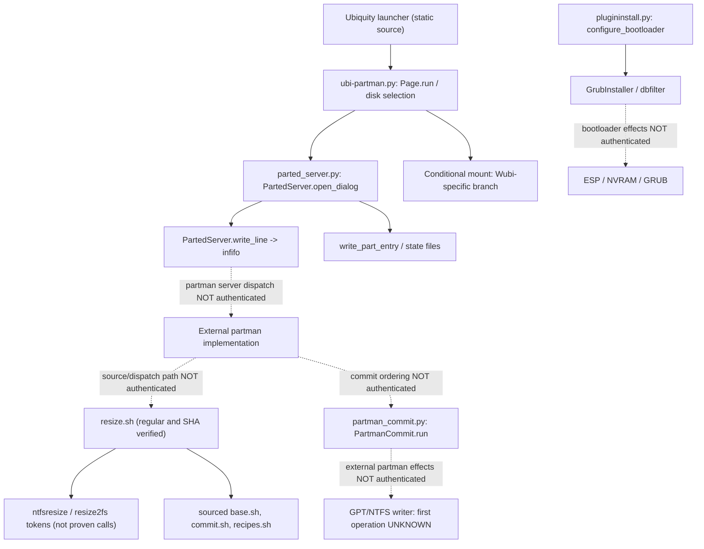

# Zorin 18.1 — FIRST-WRITER-02: source provenance and causal boundaries

**2026-11-22 UTC · ROUTE B · UBIQUITY_PRECOMMIT_PLAN_UNAVAILABLE · DENY_NO_WRITER.**

This document distinguishes what the actual SHA-pinned ISO *contains* from
what the Ubiquity installer *executes*. No Ubiquity, partman, mkfs, GRUB,
QEMU, guest or Windows partition was executed or modified by this work.

## Source identity and controlled provenance

The original [PR #264](https://github.com/LMhdez/gaslux/pull/264)
[Actions #44891962800](https://github.com/LMhdez/gaslux/actions/runs/44891962800)
artifact ZIP has SHA-256
`641bf31056addd3e54126d3e636ea524d12d0a4ac16e4188510aef8ae1f08da9`;
the historical Ubiquity map JSON has SHA-256
`47f42ce781af0eb39bc19f6c3bf4f2fb20569c5467a8f17d8e6d84b273a08f24`.
The Zorin OS **18.1 Core** ISO is 3 909 091 328 bytes, SHA-256
`44649b97bd307fc4c8529205d098ebbf98575a1e1ba2ee7d7005b697af1721d5`.
Both the ISO size and **full digest** were verified in the GitHub-hosted
read-only CI before reading individual SquashFS members.

Original six hashed regular code bodies from the #264 map:

| File in SquashFS | SHA-256 |
| --- | --- |
| `usr/bin/ubiquity` | `5819ac97c623085d08e55c08afc12e7d70be98795e603b27807bea165fad0b1b` |
| `usr/lib/ubiquity/plugins/ubi-partman.py` | `295e4785bb9477f00c3df565a4698635631d36c5c74f40b87d302578c3a6e50f` |
| `usr/lib/ubiquity/ubiquity/parted_server.py` | `5e20b10341852549ffcc5620fd0eeb35600fba0a7e84d1b306027ad8b82b7952` |
| `usr/lib/ubiquity/ubiquity/components/partman_commit.py` | `3de7e27675e1875848c4abc50b40742c5f3c68e92d7b23f54001839851527322` |
| `usr/lib/ubiquity/ubiquity/components/grubinstaller.py` | `4f2b1e80d5401abf9164f534044162483f6d37df730dff7842ec1d651fad5579` |
| `usr/share/ubiquity/plugininstall.py` | `bf3d60094d1ab2609b6260a61b675581a5efb79f7044a0c0383f3733e52e3b20` |

**New, independently read-only-attested source bodies** from the same complete
SHA-validated ISO (not pre-existing SHA values from #264):

| Actual regular member | SHA-256 recalculated in CI | Bytes |
| --- | --- | --- |
| `usr/lib/partman/lib/commit.sh` | `02426cba0f30c8165eebe4371aa7c97d9574f6cff62c7ffc634945a511c5e9ff` | 5 032 |
| `usr/lib/partman/lib/resize.sh` | `c8818727a25efff0c8430c29cead5a8f8d2b1319802a53995e8e2f025822e339` | 14 441 |

**Path resolution without following symlinks automatically:** the exact
`unsquashfs -ll` metadata for `lib` reports symlink text `lib -> usr/lib`.
The original paths `lib/partman/lib/commit.sh` and `resize.sh` return
only the SquashFS root when requested directly; **no inode identity** may
be inferred from that result. New, independently allowlisted metadata reads
at `usr/lib/partman/lib/{commit,resize}.sh` report regular inodes. Only
after the full ISO digest check, symlink textual evidence and independent
regular-file check does the dedicated two-path reader read those bytes.
The original #344 allowlist was *not* widened.
**The dpkg package ownership and runtime execution of both scripts are
not independently authenticated.**

Evidence: [Actions #45037044465](https://github.com/LMhdez/gaslux/actions/runs/45037044465),
[read-only text artifact #14760226981](https://github.com/LMhdez/gaslux/actions/runs/45037044465/artifacts/14760226981)
(artifact SHA-256
`b9ee9bb7d24a671f3760dfdd0d035f1d2857865132e24e9039eb05ac513b21ae`).
It contains only bounded metadata/calls, not the source bodies.

## Static call/effect graph — **not** a verified runtime trace

**Solid arrows** reflect source-level named calls or references, not
executed instructions. **Dashed arrows** are explicitly unverified
dispatch, source-loading, physical-write or boot effects. The diagram
**must not** be represented as a complete or authenticated action graph.

## Precise source-level boundaries

| Static evidence | Source function and lines | Candidate effects | What is **not** established |
| --- | --- | --- | --- |
| State-file roots | `parted_server.py` module assignments lines 30–34 | `/var/lib/partman/devices`, `infifo`, `outfifo`, `stopfifo`, `/var/log/partman` | No automatic equivalence to selected disk/GPT |
| Log append | `PartedServer.log` line 65 | `open(logfile, "a")` | Could write live-system log; no Windows/target disk proof |
| Command exchange | `PartedServer.open_dialog` line 138 → `write_line` lines 69–71 | Writes and flushes FIFO to external partman process | Server side/real arguments/effects unverified |
| Partman staging state | `PartedServer.write_part_entry` lines 185–187 | `open(part_entry(...), "w")`, write data under partman devices tree | Not a proven GPT/NTFS write |
| Staging-file removals | `PartedServer.remove_part_entry` lines 189–195; `mkdir_part_entry` 199–202 | `rmtree`, `unlink`, `mkdir` in partman state paths | Runtime reachability unknown |
| Branch-specific external mount | `ubi-partman.py Page.run` lines 2597, 2601, 2649, 2657 | `subprocess.check_call(['mount', device, mount_path])` only on `question.endswith('automatically_partition')` and `try_for_wubi and partition_table_full` branch | Not an unconditional native-install path; filesystem journal writes remain possible but unproven |
| Partman command examples | `ubi-partman.py Page.run` lines 2855, 3445 | `open_dialog('GET_LABEL_TYPE')`, `open_dialog('UNDO')` | External command semantics/effects not authenticated |
| Partman confirmation | `PartmanCommit.run` lines 51/60/62/91/93, `FilteredCommand.run` 97 | preseed/confirmation may lead to external code | **Not proved to be the first writer** |
| Resize script source references | `usr/lib/partman/lib/resize.sh` lines 1–3 | sources `base.sh`, `commit.sh`, `recipes.sh` through `/lib/partman/lib/` | Dependency bodies and dispatch are not all independently authenticated |
| NTFS and ext4 operations | `resize.sh` lexical references: `ntfsresize` lines 41–44, 101–114; `resize2fs` lines 418–433 | **Potential physical filesystem mutation**, depending on flags, conditional branch, source execution and target disk | A lexical occurrence is not proof of invocation, write or chronology |
| Commit script tokens | `usr/lib/partman/lib/commit.sh` lines 19/53/82/86/99/105/186/193 | Static references to partman/format/commit | Shell control flow, external effects and ordering unverified |
| GRUB and EFI | `grubinstaller.py GrubInstaller.run` 42–48; `plugininstall.py Install.configure_bootloader` 941, 969–994 | conditional `dbfilter.run_command` and bootloader actions | ESP ownership, GRUB files and NVRAM writes not observed |

## Four distinct conclusions

1. **Static callsite identified:** yes. Every Python call record is
   `STATIC_CALLSITE_NOT_EXECUTION`; each shell match is
   `STATIC_SHELL_TOKEN_NOT_EXECUTION`.
2. **Runtime reachability established:** no. The AST includes conditional
   branches but does not prove actual installation sequence. Dynamic shell,
   sourced files, external commands and the partman server are outside
   the authenticated effect graph.
3. **First potentially persistent operation located:** source includes
   `open(logfile, "a")` (live log), `open(part_entry, "w")` (partman state),
   a Wubi-conditional `mount`, and possible target-mutation tools
   `ntfsresize`/`resize2fs` in `resize.sh`. Their *runtime order*
   and any actual impact on the Windows disk are unknown. The earliest
   **physical target-disk writer cannot be identified conclusively**.
4. **First persisted GPT/NTFS write demonstrated:** **no**.
   No installation was executed, no block-level trace was obtained,
   no independently verified action graph/dry-run exists. ROUTE B.

## Automated regression and safety

`auto_tests/tools/zorin_ubiquity_first_writer_evidence.py` is specific
to the eight SHA-verified Zorin source files. It reuses the existing
#344 full-ISO authentication, original source-map checks and independent
regular-member routines. It has no write interface and no dynamic imports
from the ISO. Shell parsing is intentionally **lexical and non-authorizing**.
The original hash allowlist from #344 is unchanged, with a separate
two-path read-only allowlist for the newly resolved scripts.

`auto_tests/test_zorin_ubiquity_first_writer_evidence.py` rejects forged
runtime effects, false dry-runs, source path escapes, symlinks, invalid
metadata, unbounded reads, malformed Python and malformed shell UTF-8.
[Actions #45037044465](https://github.com/LMhdez/gaslux/actions/runs/45037044465)
completed **151 offline tests**, Ruff and compileall, and successful pinned
ISO inspection on the observed exact source HEAD
`18520990bc992b0fd8a8ca33c520864cd14be6a3`.

The Safety review for this differential must remain independent.
**No Windows partition, QEMU guest, hardware disk, ESP/BCD/WinRE/NVRAM,
partman, Ubiquity, mkfs or GRUB was executed or altered.**

## NEXT_ACTION — executable only as read-only investigation

Audit the actual partman server/backend and sourced
`/usr/lib/partman/lib/base.sh`, `recipes.sh`, plus any invoked helper
executables using the same pinned ISO provenance. Build a complete
static dependency map and independently validate where `ntfsresize`
is invoked with parameters and which disk/partition it could reach.
A host-controlled writer fence, authenticated GPT/FD ownership and
restorable Windows checkpoint remain mandatory **before** any VM
write experiment; this document grants no such permission.

**Final classification:
`ROUTE_B / UBIQUITY_PRECOMMIT_PLAN_UNAVAILABLE / DENY_NO_WRITER`.
`nativeInstallerInvoked=false`,
`productionStorageWritesAuthorized=false`,
`windowsEspWriteAuthorized=false`,
`sameDiskDualBootVerified=false`,
`windowsInPlaceRollbackProven=false`,
`stable=false`.**
